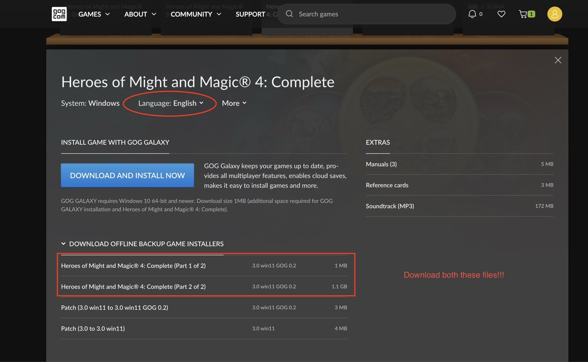

# ReHoMM4: Heroes of Might and Magic IV, native

Native port of Heroes of Might and Magic IV (including both expansions) for macOS, iOS, iPadOS, Android (including Android TV), Linux, Steam Deck, and Nintendo Switch. Runs directly on hardware—no Wine, emulators, or VMs.

[Українською — нижче](#українською)

If you enjoy it, you can support the author (also the ☕ button in the game's main menu):

[](https://ko-fi.com/hazzard)

- English, the original, or a translation: Ukrainian today (interface, campaigns, campaign
  voice-over; The Gathering Storm stays in English), and every language added to
  [ReHoMM4-translations](https://github.com/evilHazzarD/ReHoMM4-translations).
- Wide screen and a sharp picture on high-resolution displays.
- Smooth animation on the adventure map and in combat.
- Touch controls on phones and tablets; saves can follow you between devices.

**What you need:**

- A purchased copy of **Heroes of Might and Magic IV: Complete Edition** from
  [GOG](https://www.gog.com/game/heroes_of_might_and_magic_4_complete). The game itself is not
  here: the app takes it from your GOG account.
- One of:
  - a Mac with macOS 13 or later (an Apple chip or Intel);
  - an iPhone or iPad with iOS / iPadOS 17 or later;
  - an Android phone, tablet or TV (64-bit, Android 10 or later; on a TV, with a gamepad);
  - a Linux PC (x86-64 or 64-bit ARM) or a Steam Deck;
  - a Nintendo Switch that runs homebrew.
- An internet connection and about 3 GB of free space.

## Install

Two steps: install the app for your device (below), then open it and let it install the game
files from your GOG copy ([First start](#first-start-the-game-files)).

All files are on the [Releases page](https://github.com/evilHazzarD/ReHoMM4/releases): open the
newest release and, under **Assets**, download the one for your device. `<version>` in the names
below is the release's number (for example `0.3`; releases before 0.3 named them
`HeroesIV-<version>-…`).

| Device | File |
|---|---|
| Mac | `reHoMM4-v<version>-macos-arm64.dmg` (Apple chip, M1 or newer) or `reHoMM4-v<version>-macos-x86_64.dmg` (Intel) |
| iPhone, iPad | `reHoMM4-v<version>-ios.ipa` |
| Android | `reHoMM4-v<version>-android_arm64.apk` |
| Linux PC, Steam Deck | `reHoMM4-v<version>-linux-x86_64.tar.gz` (x86-64), `reHoMM4-v<version>-linux-arm64.tar.gz` (64-bit ARM) |
| Nintendo Switch | `reHoMM4-v<version>-switch.nro` |

Not sure which Mac you have:  → **About This Mac**; "Chip: Apple M…" is an Apple chip,
"Processor: … Intel" is Intel.

### Mac

1. Open the downloaded `.dmg` (double-click it in **Downloads**).
2. In the window that opens, drag **ReHoMM4** onto **Applications**. Then eject the disk
   ("Heroes IV" in Finder's sidebar → ⏏).
3. Open **Applications** and double-click **ReHoMM4**. The app is not signed by Apple, so
   the first time macOS refuses to open it:
   - **macOS 15 (Sequoia) and later:** click **Done** in the message, open  →
     **System Settings** → **Privacy & Security**, scroll down to *"ReHoMM4" was blocked…*,
     click **Open Anyway** and confirm with your password; then **Open Anyway** once more.
   - **macOS 13 and 14:** right-click (or Control-click) **ReHoMM4** → **Open** → **Open**.

   From then on it opens normally.

**Update:** download the new `.dmg` (or use ⚙ → **Check for updates** in the game) and drag the
new **ReHoMM4** onto **Applications** → **Replace**. Saves and settings are kept (they are in
`~/Library/Application Support/ReHoMM4`). Versions up to 0.3 were called **Heroes IV** in
Applications: move that one to the Bin.

### iPhone, iPad

Apps from outside the App Store are installed with a sideloading tool that signs them with your
own Apple ID; a free Apple ID is enough.

1. On a Mac or Windows PC install [AltStore](https://altstore.io) (with AltServer) or
   [Sideloadly](https://sideloadly.io) and follow its set-up guide (it needs iTunes/iCloud for
   Windows on a PC, the iPhone/iPad connected by cable the first time).
2. Copy `reHoMM4-v<version>-ios.ipa` to the computer (AltStore: or to the iPhone's Files) and
   install it: AltStore → **My Apps** → **+** → pick the `.ipa`; Sideloadly → drag the `.ipa` in,
   enter your Apple ID → **Start**.
3. On iOS/iPadOS 16 and later turn on **Developer Mode**: Settings → **Privacy & Security** →
   **Developer Mode** → on, restart, confirm **Turn On**.
4. Trust your Apple ID: Settings → **General** → **VPN & Device Management** → your Apple ID →
   **Trust**.
5. Open **Heroes IV**.

With a free Apple ID the signature lasts **7 days**: refresh the app before then (AltStore does it
by itself while AltServer runs on the computer in the same Wi-Fi; Sideloadly: install it again).
An expired app does not open, but its saves stay; refreshing brings it back.

**Update:** install the new `.ipa` the same way, over the old app.

### Android

Android 10 or later, 64-bit (almost every phone and tablet since 2019).

1. On the phone, download `reHoMM4-v<version>-android_arm64.apk` (open the Releases page in the
   phone's browser).
2. Open it: from the browser's downloads, or **Files** → **Downloads**.
3. Android asks to allow installing apps from this source (the browser or Files): **Settings** →
   turn on **Allow from this source** → back → **Install**.
4. If Play Protect warns about an unknown app: **More details** → **Install anyway**.
5. Open **Heroes IV**.

**Update:** download the new `.apk` (or use ⚙ → **Check for updates** in the game; the
notification installs it) and install it over the old one; saves are kept.

**Android TV:** the same `.apk`. It shows up in the TV's launcher and is played with a gamepad
(Xbox, PlayStation, Switch or any other Bluetooth/USB pad: the left stick moves the pointer, the
buttons are set in ⚙ → **Gamepad**); the TV remote cannot play it. Install it with a file manager
from a USB stick, or from a computer: `adb connect <TV's IP address>`, then `adb install`
`reHoMM4-v<version>-android_arm64.apk`. The TV needs a 64-bit Android with Vulkan: many TV boxes
and sticks run 32-bit Android and cannot install it.

### Linux

An x86-64 or 64-bit ARM (arm64) PC with glibc 2.36 or later (Debian 12, Ubuntu 22.10, Fedora 37,
SteamOS 3 and newer), Vulkan graphics drivers, X11 or Wayland (through Xwayland). On ARM, take
`…-linux-arm64.tar.gz` instead of `…-linux-x86_64.tar.gz` below.

1. Unpack the archive where the game should live, for example `~/Games`:
   ```sh
   mkdir -p ~/Games
   tar -xzf ~/Downloads/reHoMM4-v<version>-linux-x86_64.tar.gz -C ~/Games
   ```
2. Start it:
   ```sh
   ~/Games/ReHoMM4/ReHoMM4
   ```
3. Optional: add it to the desktop's application menu:
   ```sh
   ~/Games/ReHoMM4/install-desktop-entry.sh
   ```

**Update:** unpack the new archive over the old folder. Saves and settings are in
`~/.local/share/ReHoMM4`, not in this folder.

### Steam Deck

1. Switch to **Desktop Mode** (Steam button → **Power** → **Switch to Desktop**).
2. In Firefox (or another browser) download `reHoMM4-v<version>-linux-x86_64.tar.gz`.
3. In **Dolphin** (the file manager) open **Downloads**, right-click the archive → **Extract** →
   **Extract archive to…** → pick e.g. `/home/deck/Games`.
4. Add it to Steam: open **Steam** → **Games** → **Add a Non-Steam Game to My Library…** →
   **Browse…** → `/home/deck/Games/ReHoMM4/ReHoMM4` → **Add Selected Programs**.
5. Start it once here in Desktop Mode: the first start installs the game (the GOG sign-in opens in
   the browser), easier with the desktop's keyboard. Then go back with **Return to Gaming Mode**:
   the game is in your library under **Non-Steam**.

Controls: the trackpads and the touch screen move the pointer, R2 or a right-trackpad click is the
left button (Steam's default for non-Steam games). For the gamepad layout ([Controls](#controls)):
the game's controller settings in Steam → **Gamepad with Mouse Trackpad**.

### Nintendo Switch

Needs a Switch that runs homebrew (Atmosphère custom firmware) and a microSD card with about
2 GB free. The Switch does not install the game itself (no GOG sign-in, no installer files):
copy a game installed on a computer from your GOG copy (the folder with `heroes4.exe`, as GOG's
installer or GOG Galaxy makes it, or the `game` folder of ReHoMM4 on a Mac or PC).

1. Put the SD card in a computer and make the folder `switch/ReHoMM4` on it.
2. Copy into it `reHoMM4-v<version>-switch.nro`, renamed to `ReHoMM4.nro`, and the installed
   game folder, renamed to `game`. The card then holds:
   ```
   switch/ReHoMM4/ReHoMM4.nro
   switch/ReHoMM4/game/heroes4.exe   (and the rest of the game)
   ```
3. Put the card back and start Atmosphère.
4. Open the homebrew menu in **title takeover**: hold **R** while starting any game from the home
   screen (not from the Album: it has too little memory for the game), then pick **Heroes IV**.

Without `switch/ReHoMM4/game` the app shows where to copy it. A game in another language works
too, with the `heroes4.exe` of the English GOG version put in its place ("An installed game" below).
Controls: the touch screen as on phones, and the Joy-Cons as a gamepad ([Controls](#controls)).
The Switch app has been tested only in the Astris emulator, not on a real console yet.

### First start: the game files

Open the app. The first time, it installs the game files. Choose one:

- **Sign in to GOG** (not on the Switch). GOG's own sign-in page opens; the app checks that your
  account owns Heroes of Might and Magic IV: Complete and downloads the game (1 GB). Signing in
  with Google, Discord, Steam or Xbox works too. The sign-in is kept only until the download is
  done. Then pick the language you want: GOG's versions are English, French, German, Spanish,
  Italian and Polish. The app installs that language's data with the English `heroes4.exe` (the
  one the app is made for), so the game plays in it. The translations of ⚙ settings (Ukrainian and
  others) work with the English version only.
- **GOG installer files.** On [gog.com](https://www.gog.com/game/heroes_of_might_and_magic_4_complete)
  download the **Windows offline installer** (`setup_heroes_of_might_and_magic_4_complete_….exe`
  and its `.bin` file) and pick them in the app (not on the Switch). GOG offers it in several
  languages. **An installer in another language** needs `heroes4.exe` from GOG's English version
  put beside its files (or picked with them); the game then plays in the installer's language. On the Mac and Linux, files in **Downloads** are found
  by themselves.
  On the game's page in your GOG library: the **Language** you want, then under
  **Download offline backup game installers** both parts, **Part 1 of 2** (1 MB, the `.exe`) and
  **Part 2 of 2** (1.1 GB, the `.bin`). The patches below them are not needed.

  
- **An installed game** (on the Switch: copied to the card, see [Nintendo Switch](#nintendo-switch)).
  Pick the folder of Heroes IV: Complete already installed (from GOG, on a Windows PC, or another
  device's `game` folder); it is copied in. Its `heroes4.exe` must be the one of GOG's English
  version (3.0). **A game in another language:** replace its `heroes4.exe` with the one from an
  English GOG installation; the rest stays as it is, and the game then plays in its own language.

Every game file is checked, then the game starts. An interrupted download continues where it
stopped. What happens to the installer files afterwards: see below.

### Language and settings

The ⚙ button in the top right corner of the main menu opens the settings: the version and the
update check at the top, the game's language (a dropdown; a translation is downloaded when it is
first chosen, and the game restarts with it on Android, the Mac and Linux, at the next start
elsewhere), fullscreen (Mac, Linux), skipping the intro movies, save sync (? tells how to set it up
on Android and Linux), the gamepad, and the game's and saves' folders. On iPhone and iPad ⚙ opens a
menu with the same choices.

### The installer files after installing

The installer (`setup_….exe` and its `.bin`, about 1 GB) is needed only once. Whether the app
deletes it depends on where it was:

| Where the installer was | After the game is installed |
|---|---|
| **In the app's own folder**: iPhone/iPad: Files → On My iPhone → Heroes IV; Android: `Android/data/games.hazzard.heroes4/files/` (copied with `adb push`); Switch: `sdmc:/switch/ReHoMM4/`; Mac: `~/Library/Application Support/ReHoMM4/`; Linux: `~/.local/share/ReHoMM4/` | **deleted**: it is a copy made for the app, and it takes space for nothing |
| **Picked in the app** from anywhere else (Files, Downloads, a USB drive, iCloud Drive…) | **kept**: these are your files, the app only reads them |
| **In Downloads** on the Mac or Linux (found by itself) | **kept** |
| Not used: the game came from your **GOG account** | nothing to delete: the app downloads the game files themselves, not the installer |

If the installation stops with an error or is cancelled, nothing is deleted: try again with the same files.

The licenses of the third-party libraries are in `THIRD_PARTY_NOTICES.txt` inside every app.

## If something goes wrong

**The Mac says "ReHoMM4 cannot be opened because the developer cannot be verified".**
Right-click the app → **Open** → **Open**.

**The installer says the files are not the right ones.** The port works only with the current GOG
version of Heroes of Might and Magic IV: Complete (the English Windows installer, version 3.0).
Installers in other languages are not supported: download the English one (translations are
chosen in ⚙ settings).

**The installation was interrupted.** Open the app again: it continues where it stopped.

**A translation does not download.** It needs the internet the first time it is chosen; try
again online.

**The game crashed or behaves oddly.** Open an [issue](https://github.com/evilHazzarD/ReHoMM4/issues),
say which device, and attach the log `h4.log` and the newest file of `crashes/`. They are in the
game's player folder:

| Device | Player folder |
|---|---|
| Mac | `~/Library/Application Support/ReHoMM4/player` (in Finder: **Cmd ⌘ + Shift + G**, paste the path, **Enter**); the log in `logs/`, crashes in `data/h4/crashes/` |
| Linux, Steam Deck | `~/.local/share/ReHoMM4/player` |
| Android | `Android/data/games.hazzard.heroes4/files/player` on the phone's storage |
| iPhone, iPad | the app's folder in the Files app or Finder: **Heroes IV** → `player` |
| Switch | `sdmc:/switch/ReHoMM4/player` |

**To remove the game:** delete the app; on the Mac also the folder
`~/Library/Application Support/ReHoMM4`, on Linux `~/.local/share/ReHoMM4` (the game files and
saves).

## Controls

As in the original game; on touch screens a tap is a click and a long press a right-click. In
addition, **F10** switches the picture smoothing filter. A gamepad works everywhere (Joy-Cons,
Steam Deck, Xbox, PlayStation, MFi): left stick the pointer, **A** click, **B** right-click, right
stick scrolls the map, the other buttons are the game's shortcuts (**X** spell, **Y** wait,
**R** defend/dig, **L** next hero, **+** end turn, **−** save…). All the gestures and buttons:
[`platforms/README.md`](platforms/README.md#controls).

## Saves on several devices

Saves can follow you between devices (all but the Switch) through iCloud Drive, Syncthing, rclone,
Round Sync, FolderSync or Nextcloud: the game keeps them in a `ReHOMM4` folder. How to turn it on
for each app: [Syncing saves between devices](platforms/README.md#syncing-saves-between-devices).

## Tested devices

The iPhone/iPad, Android, Mac and Linux apps have been tested on real devices; the Intel Mac app so far
only under Rosetta on an Apple Silicon Mac. The Switch app has
not been tested: the author has no Switch with custom firmware to run homebrew on. Reports from
Switch owners are welcome in the [issues](https://github.com/evilHazzarD/ReHoMM4/issues).

## Translations

**Languages today:** English (the original game, built into every app) and **Ukrainian** (interface,
campaigns, the campaigns' voice-over; The Gathering Storm stays in English). There are no other
languages yet.

The translations are not in this repository: they live in their own,
[ReHoMM4-translations](https://github.com/evilHazzarD/ReHoMM4-translations), and reach the apps
only through its releases. The apps check its latest release at every start and download a
language when it is first chosen (⚙ → Game language). A new or corrected
language needs no new app.

**Making your own language.** The full guide is
[TRANSLATING.md](https://github.com/evilHazzarD/ReHoMM4-translations/blob/main/TRANSLATING.md); in
short:

1. **Check that the game can show it.** Heroes IV writes one byte per letter in a single Windows code
   page: languages in cp1250–cp1257 work (Polish, Czech, German, French, Spanish, Italian,
   Portuguese, Russian, Bulgarian, Greek, Turkish, the Baltic languages…). Chinese, Japanese, Korean,
   Arabic, Hebrew, Thai and others would need changes to the game's text drawing.
2. **Get the tools:** a GOG copy of the game (its `Data/` folder; in a checkout of this repository,
   `game/`), Python 3.9+, and a Mac for drawing the letters into the game's fonts (the other steps
   work anywhere).
3. **Create the language** in a fork of ReHoMM4-translations, for example Czech:
   `python3 tools/new_language.py cs cp1250 "Čeština" "Czech"`, then bring in the English text and
   build the fonts (step 3 of the guide).
4. **Translate** the files in `languages/cs/text/` (with `GLOSSARY.md` for your names and terms).
5. **Try it in the game:** `python3 tools/pack.py cs /path/to/game`, or build an app with your
   language inside: `H4_TRANSLATIONS_DIR=<your translations checkout> platforms/build.sh <platform>`.
6. **Share it:** `python3 tools/export.py cs`, `python3 tools/check.py cs`, commit, and open a pull
   request to ReHoMM4-translations. Once it is in a release, every app offers it.

Recording the campaigns' narration in your language is optional (step 7 of the guide).

**A language GOG sells the game in** (an official translation) needs no translating:
its pack is made from GOG's localized installer as it is (text, fonts, pictures with words,
voice-over), while the app keeps running the English game. Only a `language.json` goes into the
repository: [Official translations](https://github.com/evilHazzarD/ReHoMM4-translations/blob/main/TRANSLATING.md#official-translations).

## How it is made

The port is made by static recompilation with [x86recomp](https://github.com/JTM-rootstorm/x86recomp):
the code of `heroes4.exe` is translated ahead of time into native code, while graphics, sound and
the window run on SDL3 (Metal on Apple devices, Vulkan on Android and Linux). The repository holds
no game code or game files.

| Path | What |
|---|---|
| `h4/` | the port: `lifter.manifest`, replaced game functions (`src/`) |
| `patches/` | changes to x86recomp, applied on a pinned commit |
| `symbols/` | function and jump-table addresses of `heroes4.exe` (from Ghidra) |
| `platforms/` | the app builds: iOS, Android, Linux, Mac and Switch (`build.sh`, a folder per platform); a Mac DMG that builds the game on the player's Mac (`macos-dmg/`) |
| `libs/innoextract/` | the GOG installer unpacker every app uses |
| `assets/icon/` | the app icons (the Heroes IV emblem) |
| `licenses/` | license texts of the third-party parts the apps carry |
| `tools/` | preparing the source build (`build.sh`), pre-publish checks (`release/`), Ghidra scripts and art tools (`re/`) |

### Building from source

On a Mac with Homebrew and your GOG installer: `tools/build.sh [path to setup_….exe]` unpacks the
game and prepares its code, then for each platform `platforms/deps.sh <platform>` and:

| Command | Result |
|---|---|
| `platforms/build.sh ios [TEAM_ID]` | `HeroesIV-ios.ipa` |
| `platforms/build.sh android` | `HeroesIV-android_arm64.apk` |
| `platforms/build.sh linux` | `HeroesIV-linux-x86_64.tar.gz` |
| `platforms/build.sh linux-arm64` | `HeroesIV-linux-arm64.tar.gz` (64-bit ARM) |
| `platforms/build.sh macos-arm64` | `ReHoMM4.app` and `HeroesIV-macos-arm64.dmg` |
| `platforms/build.sh macos-x86_64` | `ReHoMM4.app` and `HeroesIV-macos-x86_64.dmg` (Intel) |
| `platforms/build.sh switch` | `ReHoMM4.nro` |

Details: [`platforms/README.md`](platforms/README.md).

The side panels beside the centred screens are not in the repository: the build
downloads [`HOMM4-extra-assets.zip`](https://github.com/evilHazzarD/ReHoMM4/releases/download/0.1/HOMM4-extra-assets.zip) by itself (or put it
into `~/Downloads` first; without it the sides are black).

**A release** is made on the maintainer's Mac in one command (the game is lifted from their own
`heroes4.exe`, which never goes to GitHub; GitHub's CI only checks the repository). The version is in
`VERSION`, the release notes are its section in [`CHANGELOG.md`](CHANGELOG.md):

```
tools/release/make_release.sh 0.3           # builds every app, checks them: .cache/release-0.3/
tools/release/make_release.sh 0.3 --draft   # then pushes tag v0.3 and makes a draft release on GitHub
```

## Credits

ReHoMM4 started from [HoMM4Deadware](https://github.com/LeoDeadware/HoMM4Deadware) by
LeoDeadware (MIT License): the port's first version and the Ukrainian translation come from it.
The files taken from it say so at their top.
The way saves are synced on the iPhone, iPad and Mac (`h4/src/save_sync_apple.mm`) is adapted
from the `cloud_saves` of [HommaRe](https://github.com/livmaster-dev/HommaRe-public) by Ilia
(MIT License).
The random map generator (New Game > Scenario > Random map, `h4/src/random_map/`) is a port of
[homm4-random-map-generator](https://github.com/tishonator/homm4-random-map-generator) by Tihomir
Ivanov, adapted and distributed with his permission. It reads what it needs from your own game
files; nothing of the game is carried.

## License

The port's own code, tools and icon: MIT (see `LICENSE`), with the parts from HoMM4Deadware under
LeoDeadware's copyright. x86recomp: MIT, by its authors; ffmpeg: LGPL 2.1+. Every app carries
`THIRD_PARTY_NOTICES.txt` with the license of everything in it (SDL3, ffmpeg, innoextract, Boost,
XZ, glslang, SPIRV-Cross, and on the Switch libnx, curl, zlib, Mesa and more), made by
`platforms/notices.py` from the build's link line. The license does not cover the game itself: it
stays yours, from GOG.

Heroes of Might and Magic is a trademark of Ubisoft. This is a fan project, unaffiliated with
Ubisoft or GOG.

---

## Українською

«Герої меча і магії IV» з обома доповненнями як рідна програма для Мака, iPhone та iPad, Android (зокрема Android TV),
Linux і Steam Deck, і Nintendo Switch. Без Wine, емуляторів і віртуальних машин: гра працює на
пристрої напряму.

Якщо вам подобається, можна підтримати автора (також кнопка ☕ у головному меню гри):

[](https://ko-fi.com/hazzard)

- Англійська (оригінал) або переклад: зараз українська (інтерфейс, кампанії, озвучка кампаній;
  доповнення The Gathering Storm лишається англійською) і кожна мова, додана до
  [ReHoMM4-translations](https://github.com/evilHazzarD/ReHoMM4-translations).
- Широкий екран і чітка картинка на дисплеях високої роздільності.
- Плавна анімація на карті й у бою.
- Керування дотиком на телефонах і планшетах; збереження можуть переходити між пристроями.

**Що потрібно:**

- Куплена гра **Heroes of Might and Magic IV: Complete Edition** на
  [GOG](https://www.gog.com/game/heroes_of_might_and_magic_4_complete). Самої гри тут немає:
  програма бере її з вашого облікового запису GOG.
- Один з пристроїв:
  - Мак з macOS 13 або новішою (процесор Apple або Intel);
  - iPhone або iPad з iOS / iPadOS 17 або новішою;
  - телефон, планшет чи телевізор на Android (64-бітний, Android 10 або новіший; на телевізорі — з геймпадом);
  - ПК з Linux (x86-64 чи 64-бітний ARM) або Steam Deck;
  - Nintendo Switch, на якому запускається homebrew.
- Інтернет і близько 3 ГБ вільного місця.

### Встановлення

Два кроки: встановіть програму для свого пристрою (нижче), потім відкрийте її, і вона встановить
файли гри з вашої копії GOG ([Перший запуск](#перший-запуск-файли-гри)).

Усі файли — на [сторінці Releases](https://github.com/evilHazzarD/ReHoMM4/releases): відкрийте
найновіший реліз і в розділі **Assets** завантажте файл для свого пристрою. `<version>` в іменах
нижче — номер релізу (наприклад, `0.3`; до 0.3 файли звалися `HeroesIV-<version>-…`).

| Пристрій | Файл |
|---|---|
| Мак | `reHoMM4-v<version>-macos-arm64.dmg` (процесор Apple, M1 або новіший) або `reHoMM4-v<version>-macos-x86_64.dmg` (Intel) |
| iPhone, iPad | `reHoMM4-v<version>-ios.ipa` |
| Android | `reHoMM4-v<version>-android_arm64.apk` |
| ПК з Linux, Steam Deck | `reHoMM4-v<version>-linux-x86_64.tar.gz` (x86-64), `reHoMM4-v<version>-linux-arm64.tar.gz` (64-бітний ARM) |
| Nintendo Switch | `reHoMM4-v<version>-switch.nro` |

Який у вас Мак:  → **Про цей Mac**; «Чип: Apple M…» — процесор Apple, «Процесор: … Intel» — Intel.

#### Мак

1. Відкрийте завантажений `.dmg` (двічі клацніть його в **«Завантаженнях»**).
2. У вікні, що відкриється, перетягніть **ReHoMM4** на **Applications**. Потім вийміть диск
   («Heroes IV» на бічній панелі Finder → ⏏).
3. Відкрийте **«Програми»** й двічі клацніть **ReHoMM4**. Програма не підписана Apple, тому
   першого разу macOS не дає її відкрити:
   - **macOS 15 (Sequoia) і новіші:** натисніть **«Готово»** в повідомленні, відкрийте  →
     **«Системні параметри»** → **«Приватність і безпека»**, прокрутіть до *«ReHoMM4» заблоковано…*,
     натисніть **«Усе одно відкрити»** й підтвердіть паролем; потім ще раз **«Усе одно відкрити»**.
   - **macOS 13 і 14:** правою кнопкою (або з Control) клацніть **ReHoMM4** → **«Відкрити»** →
     **«Відкрити»**.

   Далі вона відкривається як звичайно.

**Оновлення:** завантажте новий `.dmg` (або ⚙ → **«Перевірити оновлення»** у грі) і перетягніть
нову **ReHoMM4** на **Applications** → **«Замінити»**. Збереження й налаштування лишаються (вони в
`~/Library/Application Support/ReHoMM4`). Версії до 0.3 звалися в «Програмах» **Heroes IV**:
перемістіть її в Кошик.

#### iPhone, iPad

Програми не з App Store встановлюються спеціальною програмою, яка підписує їх вашим Apple ID;
безкоштовного Apple ID досить.

1. На Маці або ПК з Windows встановіть [AltStore](https://altstore.io) (з AltServer) або
   [Sideloadly](https://sideloadly.io) і виконайте їхню інструкцію з налаштування (на ПК потрібні
   iTunes та iCloud для Windows; першого разу iPhone/iPad під'єднано кабелем).
2. Скопіюйте `reHoMM4-v<version>-ios.ipa` на комп'ютер (для AltStore — або у «Файли» на iPhone) і
   встановіть: AltStore → **My Apps** → **+** → оберіть `.ipa`; Sideloadly → перетягніть `.ipa`,
   введіть Apple ID → **Start**.
3. На iOS/iPadOS 16 і новіших увімкніть **режим розробника**: Параметри → **«Приватність і
   безпека»** → **«Режим розробника»** → увімкнути, перезапуск, підтвердіть **«Увімкнути»**.
4. Довіртеся своєму Apple ID: Параметри → **«Загальні»** → **«Керування VPN і пристроями»** → ваш
   Apple ID → **«Довіряти»**.
5. Відкрийте **Heroes IV**.

З безкоштовним Apple ID підпис діє **7 днів**: оновіть програму до того (AltStore робить це сам,
поки AltServer працює на комп'ютері в тій самій Wi-Fi; у Sideloadly — встановіть ще раз).
Прострочена програма не відкривається, але збереження лишаються; після оновлення підпису все працює.

**Оновлення:** встановіть новий `.ipa` так само, поверх старої програми.

#### Android

Android 10 або новіший, 64-бітний (майже всі телефони й планшети з 2019 року).

1. На телефоні завантажте `reHoMM4-v<version>-android_arm64.apk` (відкрийте сторінку Releases у
   браузері телефона).
2. Відкрийте його: із завантажень браузера або **«Файли»** → **«Завантаження»**.
3. Android попросить дозволити встановлення програм із цього джерела (браузера чи «Файлів»):
   **«Налаштування»** → увімкніть **«Дозволити з цього джерела»** → назад → **«Встановити»**.
4. Якщо Play Protect попереджає про невідому програму: **«Докладніше»** → **«Усе одно встановити»**.
5. Відкрийте **Heroes IV**.

**Оновлення:** завантажте новий `.apk` (або ⚙ → **«Перевірити оновлення»** у грі; встановлюється
зі сповіщення) і встановіть поверх старого; збереження лишаються.

**Android TV:** той самий `.apk`. Гра з'являється в меню телевізора, грати в неї треба геймпадом
(Xbox, PlayStation, Switch чи будь-яким іншим Bluetooth/USB-геймпадом: лівий стік рухає курсор,
кнопки налаштовуються в ⚙ → **«Геймпад»**); пультом від телевізора грати не вийде. Встановіть її
файловим менеджером із флешки або з комп'ютера: `adb connect <IP-адреса телевізора>`, потім
`adb install` `reHoMM4-v<version>-android_arm64.apk`. Телевізору потрібні 64-бітний Android і
Vulkan: багато ТВ-приставок і стіків працюють на 32-бітному Android, і на них гра не встановиться.

#### Linux

ПК x86-64 чи 64-бітний ARM (arm64) з glibc 2.36 або новішою (Debian 12, Ubuntu 22.10, Fedora 37,
SteamOS 3 і новіші), драйвери з Vulkan, X11 або Wayland (через Xwayland). На ARM беріть
`…-linux-arm64.tar.gz` замість `…-linux-x86_64.tar.gz` нижче.

1. Розпакуйте архів туди, де житиме гра, наприклад у `~/Games`:
   ```sh
   mkdir -p ~/Games
   tar -xzf ~/Downloads/reHoMM4-v<version>-linux-x86_64.tar.gz -C ~/Games
   ```
2. Запустіть:
   ```sh
   ~/Games/ReHoMM4/ReHoMM4
   ```
3. За бажанням додайте її в меню програм:
   ```sh
   ~/Games/ReHoMM4/install-desktop-entry.sh
   ```

**Оновлення:** розпакуйте новий архів поверх старої теки. Збереження й налаштування — у
`~/.local/share/ReHoMM4`, не в цій теці.

#### Steam Deck

1. Перейдіть у **режим робочого столу** (кнопка Steam → **Power** → **Switch to Desktop**).
2. У Firefox (чи іншому браузері) завантажте `reHoMM4-v<version>-linux-x86_64.tar.gz`.
3. У **Dolphin** (файловий менеджер) відкрийте **Downloads**, правою кнопкою на архіві → **Extract** →
   **Extract archive to…** → оберіть, наприклад, `/home/deck/Games`.
4. Додайте в Steam: **Steam** → **Games** → **Add a Non-Steam Game to My Library…** →
   **Browse…** → `/home/deck/Games/ReHoMM4/ReHoMM4` → **Add Selected Programs**.
5. Запустіть її раз тут, у режимі робочого столу: перший запуск встановлює гру (вхід у GOG
   відкривається в браузері), з клавіатурою робочого столу простіше. Потім **Return to Gaming Mode**:
   гра у вашій бібліотеці в розділі **Non-Steam**.

Керування: трекпади й сенсорний екран рухають курсор, R2 або натискання правого трекпада — ліва
кнопка (стандартне для ігор не зі Steam). Для розкладки геймпада ([Керування](#керування)): у
налаштуваннях контролера гри в Steam → **Gamepad with Mouse Trackpad**.

#### Nintendo Switch

Потрібна Switch, що запускає homebrew (кастомна прошивка Atmosphère), і microSD з ~2 ГБ вільного
місця. Switch не встановлює гру сама (ні входу в GOG, ні файлів інсталятора): скопіюйте гру,
встановлену на комп'ютері з вашої копії GOG (теку з `heroes4.exe`, як її робить інсталятор GOG
чи GOG Galaxy, або теку `game` ReHoMM4 на Mac чи ПК).

1. Вставте SD-картку в комп'ютер і створіть на ній теку `switch/ReHoMM4`.
2. Скопіюйте в неї `reHoMM4-v<version>-switch.nro`, перейменувавши на `ReHoMM4.nro`, і теку
   встановленої гри, перейменувавши на `game`. На картці:
   ```
   switch/ReHoMM4/ReHoMM4.nro
   switch/ReHoMM4/game/heroes4.exe   (і решта гри)
   ```
3. Поверніть картку й запустіть Atmosphère.
4. Відкрийте homebrew-меню в режимі **title takeover**: тримайте **R**, запускаючи будь-яку гру з
   головного екрана (не з «Альбому»: там замало пам'яті для гри), і оберіть **Heroes IV**.

Без `switch/ReHoMM4/game` програма покаже, куди її скопіювати. Гра іншою мовою теж підходить, якщо
замінити в ній `heroes4.exe` на файл з англійської версії GOG («Встановлена гра» нижче).
Керування: сенсорний екран як на телефонах і Joy-Con як геймпад ([Керування](#керування)). Програму
для Switch перевірено лише в емуляторі Astris, на справжній консолі — ще ні.

#### Перший запуск: файли гри

Відкрийте програму. Першого разу вона встановлює файли гри. Оберіть одне:

- **Увійти в GOG** (крім Switch). Відкривається сторінка входу GOG; програма перевіряє, що на
  вашому обліковому записі є Heroes of Might and Magic IV: Complete, і завантажує гру (1 ГБ). Вхід
  через Google, Discord, Steam чи Xbox теж працює. Вхід зберігається лише до кінця завантаження.
  Потім оберіть бажану мову: у GOG є англійська, французька, німецька, іспанська, італійська й
  польська версії. Програма встановлює дані цієї мови з англійським `heroes4.exe` (під який її
  зроблено), тож гра йде цією мовою. Переклади з налаштувань ⚙ (українська та інші) працюють лише
  з англійською версією.
- **Файли інсталятора GOG.** На [gog.com](https://www.gog.com/game/heroes_of_might_and_magic_4_complete)
  завантажте **офлайн-інсталятор для Windows** (`setup_heroes_of_might_and_magic_4_complete_….exe`
  і його файл `.bin`) і оберіть їх у програмі (не на Switch). GOG пропонує його кількома мовами.
  **Інсталятору іншою мовою** потрібен `heroes4.exe` з англійської версії GOG поруч з його файлами
  (або обраний разом з ними); тоді гра йде мовою інсталятора. На Маці й Linux файли з теки **«Завантаження»** знаходяться
  самі.
  На сторінці гри у вашій бібліотеці GOG: потрібна **Language**, далі в розділі
  **Download offline backup game installers** обидві частини — **Part 1 of 2** (1 МБ, `.exe`) і
  **Part 2 of 2** (1,1 ГБ, `.bin`). Патчі під ними не потрібні.

  
- **Встановлена гра** (на Switch: копіюється на картку, див. [Nintendo Switch](#nintendo-switch-1)).
  Оберіть теку вже встановленої Heroes IV: Complete (з GOG, на комп'ютері з Windows або теку
  `game` з іншого пристрою), її буде скопійовано. Її `heroes4.exe` має бути з англійської версії
  GOG (3.0). **Гра іншою мовою:** замініть у ній `heroes4.exe` на файл з англійської інсталяції
  GOG; решта лишається як є, і гра йде своєю мовою.

Кожен файл гри перевіряється, далі гра запускається. Перерване завантаження продовжується з того
місця, де зупинилося. Що буває з файлами інсталятора потім — див. нижче.

#### Мова й налаштування

Кнопка ⚙ у правому верхньому куті головного меню відкриває налаштування: угорі версію й перевірку
оновлень, мову гри (випадний список; переклад завантажується, коли його обрано вперше, і гра
перезапускається з ним на Android, Маку й Linux, деінде — з наступного запуску), повноекранний режим
(Мак, Linux), пропуск вступних відео, синхронізацію збережень («?» пояснює, як її налаштувати, на
Android і Linux), геймпад, теки гри й збережень. На iPhone і iPad ⚙ відкриває меню з тими самими
пунктами.

#### Файли інсталятора після встановлення

Інсталятор (`setup_….exe` і його `.bin`, приблизно 1 ГБ) потрібен лише раз. Чи видалить його
програма, залежить від того, де він лежав:

| Де лежав інсталятор | Після встановлення гри |
|---|---|
| **У папці самої програми**: iPhone/iPad: «Файли» → «На iPhone» → Heroes IV; Android: `Android/data/games.hazzard.heroes4/files/` (скопійовано через `adb push`); Switch: `sdmc:/switch/ReHoMM4/`; Мак: `~/Library/Application Support/ReHoMM4/`; Linux: `~/.local/share/ReHoMM4/` | **видаляється**: це копія для програми, і вона даремно займає місце |
| **Обрано в програмі** з будь-якого іншого місця («Файли», «Завантаження», флешка, iCloud Drive…) | **лишається**: це ваші файли, програма їх лише читає |
| **У «Завантаженнях»** на Маці чи Linux (знайдено самостійно) | **лишається** |
| Не потрібен: гру встановлено з **облікового запису GOG** | видаляти нічого: програма завантажує самі файли гри, а не інсталятор |

Якщо встановлення зупинилося з помилкою чи його скасовано, нічого не видаляється: спробуйте ще
раз з тими самими файлами.

Ліцензії сторонніх бібліотек — у `THIRD_PARTY_NOTICES.txt` у кожній програмі.

### Якщо щось пішло не так

**Мак пише «Heroes IV не можна відкрити, бо розробника не перевірено».** Клацніть по програмі
правою кнопкою → **«Відкрити»** → **«Відкрити»**.

**Інсталятор каже, що файли не ті.** Порт працює тільки з актуальною версією Heroes of Might and
Magic IV: Complete з GOG (англійський інсталятор для Windows, версія 3.0). Інсталятори іншими
мовами не підходять: завантажте англійський (переклади обираються в налаштуваннях ⚙).

**Встановлення перервалося.** Відкрийте програму ще раз: вона продовжить з того місця, де
зупинилася.

**Переклад не завантажується.** Першого разу, коли мову обрано, потрібен інтернет; спробуйте ще
раз онлайн.

**Гра вилетіла або поводиться дивно.** Створіть [issue](https://github.com/evilHazzarD/ReHoMM4/issues),
напишіть, на якому пристрої, і додайте журнал `h4.log` та найновіший файл з `crashes/`. Вони в теці
гравця:

| Пристрій | Тека гравця |
|---|---|
| Мак | `~/Library/Application Support/ReHoMM4/player` (у Finder: **Cmd ⌘ + Shift + G**, вставте шлях, **Enter**); журнал у `logs/`, вильоти в `data/h4/crashes/` |
| Linux, Steam Deck | `~/.local/share/ReHoMM4/player` |
| Android | `Android/data/games.hazzard.heroes4/files/player` у пам'яті телефона |
| iPhone, iPad | тека програми в «Файлах» або у Finder: **Heroes IV** → `player` |
| Switch | `sdmc:/switch/ReHoMM4/player` |

**Видалити гру:** видаліть програму; на Маці також теку `~/Library/Application Support/ReHoMM4`, на
Linux — `~/.local/share/ReHoMM4` (файли гри й збереження).

### Керування

Як в оригінальній грі; на сенсорних екранах дотик — це клік, довге натискання — правий клік.
Додатково: **F10** перемикає фільтр згладжування картинки. Геймпад працює всюди (Joy-Con, Steam
Deck, Xbox, PlayStation, MFi): лівий стік — курсор, **A** — клік, **B** — правий клік, правий стік
прокручує мапу, решта кнопок — гарячі клавіші гри (**X** — магія, **Y** — чекати, **R** —
захист/копати, **L** — наступний герой, **+** — кінець ходу, **−** — збереження…). Усі жести й
кнопки: [`platforms/README.md`](platforms/README.md#controls).

### Збереження на кількох пристроях

Збереження можна синхронізувати між пристроями (крім Switch) через iCloud Drive, Syncthing, rclone,
Round Sync, FolderSync чи Nextcloud: гра тримає їх у папці `ReHOMM4`. Як увімкнути для кожної
програми: [Syncing saves between devices](platforms/README.md#syncing-saves-between-devices).

### Перевірені пристрої

Програми для iPhone/iPad, Android, Мака й Linux перевірено на справжніх пристроях; програму для Мака
з Intel поки що — лише через Rosetta на Маці з процесором Apple. Програма для
Switch не перевірена: автор не має Switch з кастомною прошивкою, на якій запускається homebrew.
Відгуки власників Switch — в [issues](https://github.com/evilHazzarD/ReHoMM4/issues).

### Переклади

**Мови зараз:** англійська (оригінальна гра, є в кожній програмі) і **українська** (інтерфейс,
кампанії, озвучення кампаній; The Gathering Storm лишається англійською). Інших мов поки немає.

Переклади не в цьому репозиторії: вони в окремому,
[ReHoMM4-translations](https://github.com/evilHazzarD/ReHoMM4-translations), і потрапляють у
програми тільки через його релізи. Програми перевіряють найновіший реліз при кожному запуску й
завантажують мову, коли її обрано вперше (⚙ → Мова гри). Нова чи
виправлена мова не потребує нової програми.

**Як зробити свою мову.** Повна інструкція —
[TRANSLATING.md](https://github.com/evilHazzarD/ReHoMM4-translations/blob/main/TRANSLATING.md)
(англійською); коротко:

1. **Перевірте, чи гра може її показати.** Heroes IV пише один байт на літеру в одній кодовій
   сторінці Windows: підходять мови з cp1250–cp1257 (польська, чеська, німецька, французька,
   іспанська, італійська, португальська, російська, болгарська, грецька, турецька, балтійські…).
   Китайська, японська, корейська, арабська, іврит, тайська та інші потребують змін у тому, як гра
   малює текст.
2. **Потрібне:** копія гри з GOG (її тека `Data/`; у копії цього репозиторію — `game/`), Python
   3.9+ і Мак, щоб намалювати літери в шрифтах гри (решта кроків працює будь-де).
3. **Створіть мову** у своєму форку ReHoMM4-translations, наприклад чеську:
   `python3 tools/new_language.py cs cp1250 "Čeština" "Czech"`, далі перенесіть англійський текст
   і зберіть шрифти (крок 3 інструкції).
4. **Перекладіть** файли в `languages/cs/text/` (з `GLOSSARY.md` для власних назв і термінів).
5. **Спробуйте в грі:** `python3 tools/pack.py cs /path/to/game` або зберіть програму з вашою мовою:
   `H4_TRANSLATIONS_DIR=<ваша копія перекладів> platforms/build.sh <платформа>`.
6. **Поділіться:** `python3 tools/export.py cs`, `python3 tools/check.py cs`, коміт і pull request у
   ReHoMM4-translations. Щойно мова потрапить у реліз, її запропонує кожна програма.

Озвучити кампанії своєю мовою — за бажанням (крок 7 інструкції).

**Мова, якою GOG продає гру** (офіційний переклад), перекладу не потребує: її пакет
робиться з локалізованого інсталятора GOG як є (текст, шрифти, картинки з написами, озвучення), а
програма й далі запускає англійську гру. У репозиторій іде лише `language.json`:
[Official translations](https://github.com/evilHazzarD/ReHoMM4-translations/blob/main/TRANSLATING.md#official-translations).

### Як це зроблено

Порт зроблено статичною рекомпіляцією за допомогою [x86recomp](https://github.com/JTM-rootstorm/x86recomp):
код `heroes4.exe` заздалегідь перекладається в нативний код, а графіка, звук і вікно працюють через
SDL3 (Metal на пристроях Apple, Vulkan на Android і Linux). У репозиторії немає ні коду, ні файлів
гри.

| Шлях | Що |
|---|---|
| `h4/` | порт: `lifter.manifest`, замінені функції гри (`src/`) |
| `patches/` | зміни до x86recomp, що накладаються на зафіксований коміт |
| `symbols/` | адреси функцій і таблиць переходів `heroes4.exe` (з Ghidra) |
| `platforms/` | збирання програм: iOS, Android, Linux, Мак і Switch (`build.sh`, по теці на платформу); DMG для Мака, який збирає гру на Маці гравця (`macos-dmg/`) |
| `libs/innoextract/` | розпаковувач інсталятора GOG, яким користуються всі програми |
| `assets/icon/` | іконки програм (емблема Heroes IV) |
| `licenses/` | тексти ліцензій сторонніх частин, що входять у програми |
| `tools/` | підготовка збирання з коду (`build.sh`), перевірки перед публікацією (`release/`), скрипти Ghidra та інструменти для арту (`re/`) |

#### Збирання з коду

На Маці з Homebrew і вашим інсталятором GOG: `tools/build.sh [шлях до setup_….exe]` розпаковує гру
й готує її код, далі для кожної платформи `platforms/deps.sh <платформа>` і:

| Команда | Результат |
|---|---|
| `platforms/build.sh ios [TEAM_ID]` | `HeroesIV-ios.ipa` |
| `platforms/build.sh android` | `HeroesIV-android_arm64.apk` |
| `platforms/build.sh linux` | `HeroesIV-linux-x86_64.tar.gz` |
| `platforms/build.sh linux-arm64` | `HeroesIV-linux-arm64.tar.gz` (64-bit ARM) |
| `platforms/build.sh macos-arm64` | `ReHoMM4.app` і `HeroesIV-macos-arm64.dmg` |
| `platforms/build.sh macos-x86_64` | `ReHoMM4.app` і `HeroesIV-macos-x86_64.dmg` (Intel) |
| `platforms/build.sh switch` | `ReHoMM4.nro` |

Подробиці: [`platforms/README.md`](platforms/README.md).

Бічних панелей поруч із центрованими екранами в репозиторії немає: перед збиранням збірка сама
завантажує [`HOMM4-extra-assets.zip`](https://github.com/evilHazzarD/ReHoMM4/releases/download/0.1/HOMM4-extra-assets.zip) (або покладіть його
у `~/Downloads` заздалегідь; без нього краї чорні).

**Реліз** робиться на Маці автора однією командою (гра перекомпільовується з його власного
`heroes4.exe`, який на GitHub не потрапляє; CI на GitHub лише перевіряє репозиторій). Версія — у
`VERSION`, текст релізу — її розділ у [`CHANGELOG.md`](CHANGELOG.md):

```
tools/release/make_release.sh 0.3           # збирає всі програми й перевіряє їх: .cache/release-0.3/
tools/release/make_release.sh 0.3 --draft   # далі пушить тег v0.4 і створює чернетку релізу на GitHub
```

### Подяки

ReHoMM4 почався з [HoMM4Deadware](https://github.com/LeoDeadware/HoMM4Deadware) від LeoDeadware
(ліцензія MIT): звідти перша версія порту й український переклад. Файли, узяті звідти, кажуть про
це на початку.
Спосіб синхронізації збережень на iPhone, iPad і Маці (`h4/src/save_sync_apple.mm`) узято з
`cloud_saves` проєкту [HommaRe](https://github.com/livmaster-dev/HommaRe-public) від Ilia (ліцензія MIT).
Генератор випадкових карт (Нова гра > Сценарій > Випадкова карта, `h4/src/random_map/`) — порт
[homm4-random-map-generator](https://github.com/tishonator/homm4-random-map-generator) Тихомира
Іванова, адаптований і поширюваний з його дозволу. Усе потрібне він бере з ваших файлів гри; нічого
з гри в ньому немає.

### Ліцензія

Власний код порту, інструменти та іконка — MIT (див. `LICENSE`), частини з HoMM4Deadware — під
авторським правом LeoDeadware. x86recomp — MIT від його авторів; ffmpeg — LGPL 2.1+. Кожна
програма містить `THIRD_PARTY_NOTICES.txt` з ліцензіями всього, що в ній (SDL3, ffmpeg,
innoextract, Boost, XZ, glslang, SPIRV-Cross, а на Switch — libnx, curl, zlib, Mesa тощо); його
складає `platforms/notices.py` з рядка лінкування збірки. На саму гру ліцензія не поширюється: вона
ваша, з GOG.

Heroes of Might and Magic — торгова марка Ubisoft. Це фанатський проєкт, не пов'язаний з Ubisoft
чи GOG.
