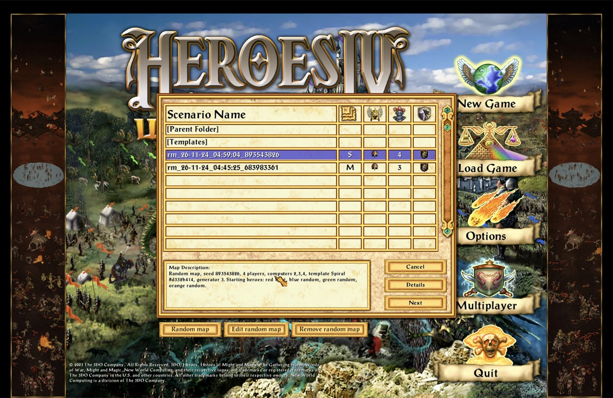
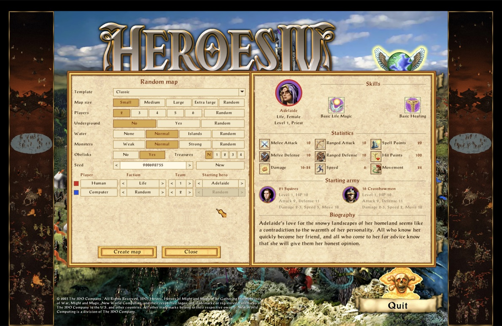

# ReHoMM4: Heroes of Might and Magic IV, native

Native port of Heroes of Might and Magic IV (including both expansions) for macOS, iOS, iPadOS, Android (including Android TV), Windows, Linux, Steam Deck, Nintendo Switch and Switch 2, and in a web browser. Runs directly on hardware—no Wine, emulators, or VMs.

**Try it in your browser: <https://evilhazzard.github.io/ReHoMM4/>** (your own GOG copy of the game
is needed; nothing is installed, the game files stay in the browser).

## Why ReHoMM4?

- **Wide screen.** Every screen fills a 16:9 (or any) display: the adventure map shows more of the
  world instead of black bars; towns and combat get side panels in the game's style.
- **A sharp, smooth picture.** The game is scaled to high-resolution displays with a choice of
  filters, AMD FSR by default ([Picture scaling](#picture-scaling)); smooth animation on the
  adventure map and in combat.
- **Many platforms, natively.** Mac, iPhone and iPad, Android (TV too), Windows, Linux, Steam Deck,
  Nintendo Switch and Switch 2, and a web browser.
- **A random map generator.** New maps from 32 templates, with your choice of size, players,
  factions, teams, starting heroes, water, underground, monsters and treasures
  ([Random maps](#random-maps)).
- **More languages.** GOG's English, German, French, Italian and Spanish editions as they are
  (Polish, Russian and Czech ones too), and translations of the English game: Ukrainian today
  (interface, campaigns, voice-over), and every language added to
  [ReHoMM4-translations](https://github.com/evilHazzarD/ReHoMM4-translations).
- **And more:** touch controls on phones and tablets, gamepads, saves that follow you between
  devices, an installer that takes the game from your GOG account, What's new and update checks
  in the settings.

If you enjoy it, you can support the author (also the ☕ button in the game's main menu):

[](https://ko-fi.com/hazzard)

## Random maps

New Game → **Scenario** → **Random map** (the button under the list of scenarios) opens the
generator. At the top choose the **template**, the map's layout of zones and roads: Classic or one
of 31 more (rings, spiders, mirrors, team maps, labyrinths…). A template made for other numbers of
players or map sizes sets them when picked. Then the map size, the players (each human or
computer, with faction, team and starting hero; the hero's card shows the skills, army and
biography), water, underground, monsters, obelisks, treasures and the seed. Most can be
**Random**. **Create map** makes the map; it is at the top of the list of scenarios.





With a random map selected in the list, **Edit random map** brings its settings back and
**Update map** makes it again in its place; **Remove random map** deletes it. Each map keeps its full settings in its description, so the same seed and settings make
the same map on every device. Templates are text files in `Maps/RandomMaps/Templates` (beside the
game files): change them or add your own; `example.txt` explains the format.

**What you need:**

- A purchased copy of **Heroes of Might and Magic IV: Complete Edition** from
  [GOG](https://www.gog.com/game/heroes_of_might_and_magic_4_complete). The game itself is not
  here: the app takes it from your GOG account.
- One of:
  - a Mac with macOS 13 or later (an Apple chip or Intel);
  - an iPhone or iPad with iOS / iPadOS 17 or later;
  - an Android phone, tablet or TV (64-bit, Android 10 or later; on a TV, with a gamepad);
  - a Windows PC (64-bit, Windows 10 or 11);
  - a Linux PC (x86-64 or 64-bit ARM) or a Steam Deck;
  - a Nintendo Switch that runs homebrew (Atmosphère), or a Switch 2 that runs homebrew (kaiHEN);
  - or a web browser on a computer, phone or tablet (64-bit Chrome, Edge, Firefox or Safari):
    **<https://evilhazzard.github.io/ReHoMM4/>** ([In a browser](#in-a-browser)).
- An internet connection and about 3 GB of free space.

## Install

Two steps: install the app for your device (below), then open it and let it install the game
files from your GOG copy ([First start](#first-start-the-game-files)).

All files are on the [Releases page](https://github.com/evilHazzarD/ReHoMM4/releases): open the
newest release and, under **Assets**, download the one for your device. `<version>` in the names
below is the release's number (for example `0.3`; releases before 0.3 named them
`HeroesIV-<version>-…`).

| Device | File |
|---|---|
| Mac | `reHoMM4-v<version>-macos-arm64.dmg` (Apple chip, M1 or newer) or `reHoMM4-v<version>-macos-x86_64.dmg` (Intel) |
| iPhone, iPad | `reHoMM4-v<version>-ios.ipa` |
| Android | `reHoMM4-v<version>-android_arm64.apk` |
| Windows PC | `reHoMM4-v<version>-windows-x86_64.zip` (from 0.4.1) |
| Linux PC, Steam Deck | `reHoMM4-v<version>-linux-x86_64.tar.gz` (x86-64), `reHoMM4-v<version>-linux-arm64.tar.gz` (64-bit ARM) |
| Nintendo Switch | `reHoMM4-v<version>-switch.nro` |
| Nintendo Switch 2 | `reHoMM4-v<version>-switch2.nro` (from 0.4; not the Switch one) |
| Web browser (computer, phone, tablet) | `reHoMM4-v<version>-web.zip` (from 0.4: the site, to serve; [In a browser](#in-a-browser)) |

Not sure which Mac you have:  → **About This Mac**; "Chip: Apple M…" is an Apple chip,
"Processor: … Intel" is Intel.

### Mac

1. Open the downloaded `.dmg` (double-click it in **Downloads**).
2. In the window that opens, drag **ReHoMM4** onto **Applications**. Then eject the disk
   ("Heroes IV" in Finder's sidebar → ⏏).
3. Open **Applications** and double-click **ReHoMM4**. The app is not signed by Apple, so
   the first time macOS refuses to open it:
   - **macOS 15 (Sequoia) and later:** click **Done** in the message, open  →
     **System Settings** → **Privacy & Security**, scroll down to *"ReHoMM4" was blocked…*,
     click **Open Anyway** and confirm with your password; then **Open Anyway** once more.
   - **macOS 13 and 14:** right-click (or Control-click) **ReHoMM4** → **Open** → **Open**.

   From then on it opens normally.

**Update:** download the new `.dmg` (or use ⚙ → **Check for updates** in the game) and drag the
new **ReHoMM4** onto **Applications** → **Replace**. Saves and settings are kept (they are in
`~/Library/Application Support/ReHoMM4`). Versions up to 0.3 were called **Heroes IV** in
Applications: move that one to the Bin.

### iPhone, iPad

Two ways: the app, installed with a sideloading tool, or the
[browser version](#in-a-browser) added to the Home Screen as a web app, with no sideloading,
no computer and no 7-day refresh ([below](#iphone-ipad-without-sideloading-the-web-app)).

Apps from outside the App Store are installed with a sideloading tool that signs them with your
own Apple ID; a free Apple ID is enough.

1. On a Mac or Windows PC install [AltStore](https://altstore.io) (with AltServer) or
   [Sideloadly](https://sideloadly.io) and follow its set-up guide (it needs iTunes/iCloud for
   Windows on a PC, the iPhone/iPad connected by cable the first time).
2. Copy `reHoMM4-v<version>-ios.ipa` to the computer (AltStore: or to the iPhone's Files) and
   install it: AltStore → **My Apps** → **+** → pick the `.ipa`; Sideloadly → drag the `.ipa` in,
   enter your Apple ID → **Start**.
3. On iOS/iPadOS 16 and later turn on **Developer Mode**: Settings → **Privacy & Security** →
   **Developer Mode** → on, restart, confirm **Turn On**.
4. Trust your Apple ID: Settings → **General** → **VPN & Device Management** → your Apple ID →
   **Trust**.
5. Open **Heroes IV**.

With a free Apple ID the signature lasts **7 days**: refresh the app before then (AltStore does it
by itself while AltServer runs on the computer in the same Wi-Fi; Sideloadly: install it again).
An expired app does not open, but its saves stay; refreshing brings it back.

**Update:** install the new `.ipa` the same way, over the old app.

#### iPhone, iPad without sideloading: the web app

The [browser version](#in-a-browser) added to the Home Screen opens as an app of its own: with its
own icon, in full screen without Safari's bars, and with no signature to refresh. It needs
iOS / iPadOS 18.2 or later and an iPhone or iPad with 4 GB of memory or more (the game takes
about 1.7 GB; on 2–3 GB devices iOS may close it).

1. Put GOG's offline installer on the device: in Safari sign in at
   [gog.com](https://www.gog.com) → **Games** → Heroes of Might and Magic IV: Complete → the
   offline backup installers → download `setup_heroes_of_might_and_magic_4_complete_….exe` and its
   `-1.bin` (1.1 GB); or copy both from a computer (AirDrop, or Finder / iTunes file sharing).
   Keep them in **Files → On My iPhone/iPad** (an iCloud Drive file not downloaded to the device
   cannot be read), and keep about 3.5 GB free for the installing.
2. Open <https://evilhazzard.github.io/ReHoMM4/> in **Safari**.
3. **Share** (the square with an arrow) → **Add to Home Screen** → with **Open as Web App** on
   (iOS 26 and later) → **Add**.
4. Open **Heroes IV** from the Home Screen (not the Safari tab: the web app keeps its own game
   files, saves and settings, apart from Safari's).
5. **Install the game** → **Install from GOG installer files** → **Choose the files** →
   **Choose Files** → **On My iPhone/iPad** → select both files → **Open**. Copying, unpacking
   and preparing the game's code take a few minutes; keep the app open meanwhile.
6. **Play**. Hold the device in landscape. A long press or a two-finger tap is a right click.

The site updates itself: the web app picks up a new version when it is opened. Removing the icon
from the Home Screen deletes the web app's game files and saves. If something fails, the page's
log (**Copy the log**) says where.

### Android

Android 10 or later, 64-bit (almost every phone and tablet since 2019).

1. On the phone, download `reHoMM4-v<version>-android_arm64.apk` (open the Releases page in the
   phone's browser).
2. Open it: from the browser's downloads, or **Files** → **Downloads**.
3. Android asks to allow installing apps from this source (the browser or Files): **Settings** →
   turn on **Allow from this source** → back → **Install**.
4. If Play Protect warns about an unknown app: **More details** → **Install anyway**.
5. Open **Heroes IV**.

**Update:** download the new `.apk` (or use ⚙ → **Check for updates** in the game; the
notification installs it) and install it over the old one; saves are kept.

**Android TV:** the same `.apk`. It shows up in the TV's launcher and is played with a gamepad
(Xbox, PlayStation, Switch or any other Bluetooth/USB pad: the left stick moves the pointer, the
buttons are set in ⚙ → **Gamepad**); the TV remote cannot play it. Install it with a file manager
from a USB stick, or from a computer: `adb connect <TV's IP address>`, then `adb install`
`reHoMM4-v<version>-android_arm64.apk`. The TV needs a 64-bit Android with Vulkan: many TV boxes
and sticks run 32-bit Android and cannot install it.

### Windows

A 64-bit PC with Windows 10 or 11 and graphics drivers with Vulkan (the current NVIDIA, AMD and Intel
drivers have it).

1. Open the folder of your installed GOG copy — the one containing `heroes4.exe`, `Data` and `maps`
   (for example `C:\GOG Games\Heroes of Might and Magic IV`). Unpack
   `reHoMM4-v<version>-windows-x86_64.zip` **into that folder** and allow it to merge files. It adds
   `ReHoMM4.exe`, its DLLs and support folders; it does not replace the game's files.
2. Start `ReHoMM4.exe`. The app is not signed, so Windows may say "Windows protected your
   PC": **More info** → **Run anyway**.

**No installed game?** Unpack the archive into any folder and start `ReHoMM4.exe`: its installer
takes GOG's offline installer (`setup_heroes_of_might_and_magic_4_complete_…exe` and its `-1.bin`,
picked in it with **Install from GOG installer files**) or downloads the game from your GOG account
(**Sign in to GOG.com and download**), into
`%LOCALAPPDATA%\ReHoMM4\game` ([First start: the game files](#first-start-the-game-files)).

**Update:** unpack the new archive over the same game folder. Saves and settings are in
`%LOCALAPPDATA%\ReHoMM4` (paste it into Explorer's address bar), not in the game folder. The older
preview location `%LOCALAPPDATA%\ReHoMM4\game` continues to work too.

### Linux

An x86-64 or 64-bit ARM (arm64) PC with glibc 2.36 or later (Debian 12, Ubuntu 22.10, Fedora 37,
SteamOS 3 and newer), Vulkan graphics drivers, X11 or Wayland (through Xwayland). On ARM, take
`…-linux-arm64.tar.gz` instead of `…-linux-x86_64.tar.gz` below.

1. Unpack the archive where the game should live, for example `~/Games`:
   ```sh
   mkdir -p ~/Games
   tar -xzf ~/Downloads/reHoMM4-v<version>-linux-x86_64.tar.gz -C ~/Games
   ```
2. Start it:
   ```sh
   ~/Games/ReHoMM4/ReHoMM4
   ```
3. Optional: add it to the desktop's application menu:
   ```sh
   ~/Games/ReHoMM4/install-desktop-entry.sh
   ```

**Update:** unpack the new archive over the old folder. Saves and settings are in
`~/.local/share/ReHoMM4`, not in this folder.

### Steam Deck

1. Switch to **Desktop Mode** (Steam button → **Power** → **Switch to Desktop**).
2. In Firefox (or another browser) download `reHoMM4-v<version>-linux-x86_64.tar.gz`.
3. In **Dolphin** (the file manager) open **Downloads**, right-click the archive → **Extract** →
   **Extract archive to…** → pick e.g. `/home/deck/Games`.
4. Add it to Steam: open **Steam** → **Games** → **Add a Non-Steam Game to My Library…** →
   **Browse…** → `/home/deck/Games/ReHoMM4/ReHoMM4` → **Add Selected Programs**.
5. Start it once here in Desktop Mode: the first start installs the game (the GOG sign-in opens in
   the browser), easier with the desktop's keyboard. Then go back with **Return to Gaming Mode**:
   the game is in your library under **Non-Steam**.

Controls: the trackpads and the touch screen move the pointer, R2 or a right-trackpad click is the
left button (Steam's default for non-Steam games). For the gamepad layout ([Controls](#controls)):
the game's controller settings in Steam → **Gamepad with Mouse Trackpad**.

### Nintendo Switch

Needs a Switch that runs homebrew (Atmosphère custom firmware) and a microSD card with about
2 GB free. The Switch does not install the game itself (no GOG sign-in, no installer files):
copy a game installed on a computer from your GOG copy (the folder with `heroes4.exe`, as GOG's
installer or GOG Galaxy makes it, or the `game` folder of ReHoMM4 on a Mac or PC).

1. Put the SD card in a computer and make the folder `switch/ReHoMM4` on it.
2. Copy into it `reHoMM4-v<version>-switch.nro`, renamed to `ReHoMM4.nro`, and the installed
   game folder, renamed to `game`. The card then holds:
   ```
   switch/ReHoMM4/ReHoMM4.nro
   switch/ReHoMM4/game/heroes4.exe   (and the rest of the game)
   ```
3. Put the card back and start Atmosphère.
4. Open the homebrew menu in **title takeover**: hold **R** while starting any game from the home
   screen (not from the Album: it has too little memory for the game), then pick **Heroes IV**.

Without `switch/ReHoMM4/game` the app shows where to copy it. A German, French, Italian or Spanish
GOG game works as it is; the Polish one with the `heroes4.exe` of the English GOG version put in its
place ("An installed game" below).
Controls: the touch screen as on phones, and the Joy-Cons as a gamepad ([Controls](#controls)).
The Switch app has been tested only in the Astris emulator, not on a real console yet.

### Nintendo Switch 2

Needs a Switch 2 that runs homebrew with [kaiHEN](https://github.com/ouncebrew/kaihen) (its
homebrew menu, hbmenu) and a microSD card with about 2 GB free. Download
`reHoMM4-v<version>-switch2.nro`: the Switch 2 needs its own build (made with
[ounce-devkit](https://github.com/ouncebrew/ounce-devkit)); `…-switch.nro` is for the first
Switch only. As on the Switch, the game is copied from a computer (no GOG sign-in on the console).

1. Put the SD card in a computer and make the folder `switch/ReHoMM4` on it.
2. Copy into it `reHoMM4-v<version>-switch2.nro`, renamed to `ReHoMM4.nro`, and the installed
   game folder, renamed to `game`:
   ```
   switch/ReHoMM4/ReHoMM4.nro
   switch/ReHoMM4/game/heroes4.exe   (and the rest of the game)
   ```
3. Put the card back and start kaiHEN (with the tool you use for it).
4. Hold **R** while starting a game from the home screen. The first time, kaiHEN runs that game
   normally and prepares itself; from the next time it opens the homebrew menu. Pick **Heroes IV**.

The game runs at the console's screen resolution (the TV's in the dock). Controls as on the
Switch. The Switch 2 app has not been tested on a console yet: reports are welcome in the
[issues](https://github.com/evilHazzarD/ReHoMM4/issues).

### In a browser

The same game, compiled to WebAssembly, runs in a browser, on a computer, phone or tablet.

**Play it at <https://evilhazzard.github.io/ReHoMM4/>.** The site has no game code: it is about
10 MB, and the first time it makes the game's code from your own GOG installer, in your browser
(a minute or two), and keeps it there. Ukrainian is offered as in the apps.

Or run it yourself: the release has a site with the game's code built in,
`reHoMM4-v<version>-web.zip`, to run on your computer or put on a web server of your own (step 1).

What it needs: a 64-bit Chrome or Edge 112+, Firefox 121+ or Safari 18.2+ (on an iPhone or iPad:
iOS / iPadOS 18.2+; on Android: Chrome), about 3 GB of free memory, and about 1.5 GB of storage
for the site. On phones and tablets the screen is touched as in the apps, and the page shows a
keyboard where the game wants text; with too little memory the browser closes the page.

1. Open <https://evilhazzard.github.io/ReHoMM4/>. Or download `reHoMM4-v<version>-web.zip` and unzip it. On a computer with
   [Python 3](https://www.python.org/downloads/), in the `ReHoMM4` folder run
   ```
   python3 serve.py
   ```
   and open http://localhost:8080. For phones and tablets put the `ReHoMM4` folder on an HTTPS
   web server (its `README.txt` says what the server must send). Or build the site from source:
   `web/build.sh`, then `python3 web/serve.py` ([Building from source](#building-from-source)).
2. Open the page and press **Play** (the game opens in the page; full screen: the **Full screen**
   box in the game's Options, or Alt+Enter). The language, the intro movies and the side panels
   are in the game's settings (⚙ in its main menu). On an iPhone or iPad it can also be added to
   the Home Screen as an app ([the web app](#iphone-ipad-without-sideloading-the-web-app)).
3. The first time the installer opens, as in the apps. Pick both files of GOG's offline installer
   (`setup_heroes_of_might_and_magic_4_complete_….exe` and its `-1.bin`, from your GOG library), or
   the folder of a game installed on this computer. "Sign in to GOG" is not offered in a browser.

The game (about 1 GB), saves and settings stay in this browser's storage, for this site only;
nothing is uploaded. **Delete the game files kept in this browser** on the page removes them;
clearing the site's data in the browser removes the saves too. **Start again** restarts the game.

The release's `web.zip` is in English. For a translation, make a folder `translations` in `ReHoMM4` and
put in it `languages.json` and the language's `.h4p` from the
[ReHoMM4-translations releases](https://github.com/evilHazzarD/ReHoMM4-translations/releases).

### First start: the game files

Open the app. The first time, it installs the game files. Choose one:

- **Sign in to GOG** (not on the Switch). GOG's own sign-in page opens; the app checks that your
  account owns Heroes of Might and Magic IV: Complete and downloads the game (1 GB). Signing in
  with Google, Discord, Steam or Xbox works too. The sign-in is kept only until the download is
  done. Then pick the language you want: GOG's versions are English, French, German, Spanish,
  Italian and Polish. The app installs that language's data with the English `heroes4.exe` (the
  one the app is made for), so the game plays in it. The translations of ⚙ settings (Ukrainian and
  others) work with the English version only.
- **GOG installer files.** On [gog.com](https://www.gog.com/game/heroes_of_might_and_magic_4_complete)
  download the **Windows offline installer** (`setup_heroes_of_might_and_magic_4_complete_….exe`
  and its `.bin` file) and pick them in the app (not on the Switch). GOG offers it in several
  languages; the English, German, French, Italian and Spanish ones install as they are, and the
  game plays in the installer's language. **The Polish installer** has a `heroes4.exe` of its own
  build: it needs the one from GOG's English version put beside its files (or picked with them). On the Mac and Linux, files in **Downloads** are found
  by themselves.
  On the game's page in your GOG library: the **Language** you want, then under
  **Download offline backup game installers** both parts, **Part 1 of 2** (1 MB, the `.exe`) and
  **Part 2 of 2** (1.1 GB, the `.bin`). The patches below them are not needed.

  
- **An installed game** (on the Switch: copied to the card, see [Nintendo Switch](#nintendo-switch)).
  Pick the folder of Heroes IV: Complete already installed (from GOG, on a Windows PC, or another
  device's `game` folder); it is copied in. Its `heroes4.exe` must be the one of GOG's 3.0 (win11
  GOG 0.2) in English, German, French, Italian or Spanish; a German, French, Italian or Spanish
  game then plays in its own language. **The Polish game or another version:** replace its
  `heroes4.exe` with the one from an English GOG installation; the rest stays as it is.

Every game file is checked, then the game starts. An interrupted download continues where it
stopped. What happens to the installer files afterwards: see below.

### Language and settings

The ⚙ button in the top right corner of the main menu opens the settings: the version and the
update check at the top, the game's language (a dropdown; a translation is downloaded when it is
first chosen, and the game restarts with it on Android, the Mac and Linux, at the next start
elsewhere), the interface language (as the game's by default), the picture scaling (iPhone, iPad, Android: see
[Controls](#picture-scaling)), skipping the intro movies, save sync (? tells how to set it up
on Android and Linux), the gamepad, and the game's and saves' folders. On iPhone and iPad ⚙ opens a
menu with the same choices.

### The installer files after installing

The installer (`setup_….exe` and its `.bin`, about 1 GB) is needed only once. Whether the app
deletes it depends on where it was:

| Where the installer was | After the game is installed |
|---|---|
| **In the app's own folder**: iPhone/iPad: Files → On My iPhone → Heroes IV; Android: `Android/data/games.hazzard.heroes4/files/` (copied with `adb push`); Switch: `sdmc:/switch/ReHoMM4/`; Mac: `~/Library/Application Support/ReHoMM4/`; Linux: `~/.local/share/ReHoMM4/` | **deleted**: it is a copy made for the app, and it takes space for nothing |
| **Picked in the app** from anywhere else (Files, Downloads, a USB drive, iCloud Drive…) | **kept**: these are your files, the app only reads them |
| **In Downloads** on the Mac or Linux (found by itself) | **kept** |
| Not used: the game came from your **GOG account** | nothing to delete: the app downloads the game files themselves, not the installer |

If the installation stops with an error or is cancelled, nothing is deleted: try again with the same files.

The licenses of the third-party libraries are in `THIRD_PARTY_NOTICES.txt` inside every app.

## If something goes wrong

**The Mac says "ReHoMM4 cannot be opened because the developer cannot be verified".**
Right-click the app → **Open** → **Open**.

**The installer says the files are not the right ones.** The port works only with the current GOG
version of Heroes of Might and Magic IV: Complete (the Windows installer, version 3.0 win11 GOG
0.2), in English, German, French, Italian or Spanish: their `heroes4.exe` are the same program (they
differ only in bytes no code reaches). The Polish one is built apart: put the English
`heroes4.exe` beside it, or download the English installer (translations are chosen in ⚙ settings).
Older installers (such as the German 3.0 of build 25023) do not work.

**The installation was interrupted.** Open the app again: it continues where it stopped.

**A translation does not download.** It needs the internet the first time it is chosen; try
again online.

**The game crashed or behaves oddly.** Open an [issue](https://github.com/evilHazzarD/ReHoMM4/issues),
say which device, and attach the log `h4.log` and the newest file of `crashes/`. They are in the
game's player folder:

| Device | Player folder |
|---|---|
| Mac | `~/Library/Application Support/ReHoMM4/player` (in Finder: **Cmd ⌘ + Shift + G**, paste the path, **Enter**); the log in `logs/`, crashes in `data/h4/crashes/` |
| Windows | `%LOCALAPPDATA%\ReHoMM4\player` |
| Linux, Steam Deck | `~/.local/share/ReHoMM4/player` |
| Android | `Android/data/games.hazzard.heroes4/files/player` on the phone's storage |
| iPhone, iPad | the app's folder in the Files app or Finder: **Heroes IV** → `player` |
| Switch | `sdmc:/switch/ReHoMM4/player` |

**To remove the game:** delete the app; on the Mac also the folder
`~/Library/Application Support/ReHoMM4`, on Windows `%LOCALAPPDATA%\ReHoMM4`, on Linux
`~/.local/share/ReHoMM4` (the game files and saves).

## Controls

As in the original game; on touch screens a tap is a click; a long press or a two-finger tap a right-click. In
addition, **F10** switches the picture scaling (below). A gamepad works everywhere (Joy-Cons,
Steam Deck, Xbox, PlayStation, MFi): left stick the pointer, **A** click, **B** right-click, right
stick scrolls the map, the other buttons are the game's shortcuts (**X** spell, **Y** wait,
**R** defend/dig, **L** next hero, **+** end turn, **−** save…). All the gestures and buttons:
[`platforms/README.md`](platforms/README.md#controls).

### Screen layout

The game has three layouts of its screens: **800x600**, **1024x768** and **1280x1024** (smaller
layouts have bigger buttons and letters). Each is widened to the screen's shape: the adventure map
fills the sides. Choose one in the game: **Options** (the main menu's or the adventure map's) →
the resolution buttons; it changes at once and is remembered (on the Switch, apart for in the
hands and on the TV, and the layout follows the dock as it changes). Until one is chosen:

| Device | Layout |
|---|---|
| iPhone, iPad, Android phones and tablets | 1024x768 |
| Mac, Windows, Linux | 1280x1024; 1024x768 when the screen is lower than 1024 points |
| Browser: on a phone or tablet / on a computer | 1024x768 / as on a computer |
| Switch 1 and 2: in the hands / on the TV | 800x600 / 1024x768 |

### Picture scaling

The game draws its picture at its own resolution; it is stretched to the screen by one of these
filters. **F10** picks the next one; on iPhone, iPad and Android, where there is no F10, it is
**⚙ → Scaling** (each tap the next one). The filter chosen is shown for two seconds at the top of
the screen with its number ("Scaling 7/7: FSR"; after 7 comes 1 again). It is remembered: the game
starts with it next time (it is kept in the file `filter` in the player folder, see
[If something goes wrong](#if-something-goes-wrong)).

| № | Filter | Looks |
|---|---|---|
| 1 | Nearest | sharp square pixels |
| 2 | Bilinear | soft, a little blurred; the cheapest |
| 3 | Sharp bilinear | crisp pixels, smoothed only at their edges |
| 4 | Bicubic | softer than nearest, sharper than bilinear |
| 5 | Lanczos | very sharp; light halos at contrasting edges |
| 6 | Sharp bicubic | bicubic with extra sharpening |
| 7 | **FSR** (the default) | AMD FidelityFX Super Resolution 1.0: the sharpest; two passes, the most work for the GPU |

On a laptop on battery, Bilinear saves the most. The Switch and the browser version draw the picture
without the GPU and have one filter, so F10 does nothing there. Start the game with the environment
variable `H4_FILTER=<name>` (`nearest`, `bilinear`, `sharp`, `bicubic`, `lanczos`, `bicubic-sharp`,
`fsr`) to set it regardless of what was chosen.

## Saves on several devices

Saves can follow you between devices (all but the Switch) through iCloud Drive, Syncthing, rclone,
Round Sync, FolderSync or Nextcloud: the game keeps them in a `ReHOMM4` folder. How to turn it on
for each app: [Syncing saves between devices](platforms/README.md#syncing-saves-between-devices).

## Tested devices

The iPhone/iPad, Android, Mac, Windows (a PC with an NVIDIA GeForce RTX 3060 Ti) and Linux apps
have been tested on real devices; the Intel Mac app so far
only under Rosetta on an Apple Silicon Mac. The Switch app has
not been tested: the author has no Switch with custom firmware to run homebrew on. Reports from
Switch owners are welcome in the [issues](https://github.com/evilHazzarD/ReHoMM4/issues).
The Switch 2 app has not been tested on a console either. The browser version has been tested in
Chrome on a Mac.

## Translations

**Languages today:** English (the original game, built into every app) and **Ukrainian** (interface,
campaigns, the campaigns' voice-over; The Gathering Storm stays in English). There are no other
languages yet.

The translations are not in this repository: they live in their own,
[ReHoMM4-translations](https://github.com/evilHazzarD/ReHoMM4-translations), and reach the apps
only through its releases. The apps check its latest release at every start and download a
language when it is first chosen (⚙ → Game language). A new or corrected
language needs no new app.

**Making your own language.** The full guide is
[TRANSLATING.md](https://github.com/evilHazzarD/ReHoMM4-translations/blob/main/TRANSLATING.md); in
short:

1. **Check that the game can show it.** Heroes IV writes one byte per letter in a single Windows code
   page: languages in cp1250–cp1257 work (Polish, Czech, German, French, Spanish, Italian,
   Portuguese, Russian, Bulgarian, Greek, Turkish, the Baltic languages…). Chinese, Japanese, Korean,
   Arabic, Hebrew, Thai and others would need changes to the game's text drawing.
2. **Get the tools:** a GOG copy of the game (its `Data/` folder; in a checkout of this repository,
   `game/`), Python 3.9+, and a Mac for drawing the letters into the game's fonts (the other steps
   work anywhere).
3. **Create the language** in a fork of ReHoMM4-translations, for example Czech:
   `python3 tools/new_language.py cs cp1250 "Čeština" "Czech"`, then bring in the English text and
   build the fonts (step 3 of the guide).
4. **Translate** the files in `languages/cs/text/` (with `GLOSSARY.md` for your names and terms).
5. **Try it in the game:** `python3 tools/pack.py cs /path/to/game`, or build an app with your
   language inside: `H4_TRANSLATIONS_DIR=<your translations checkout> platforms/build.sh <platform>`.
6. **Share it:** `python3 tools/export.py cs`, `python3 tools/check.py cs`, commit, and open a pull
   request to ReHoMM4-translations. Once it is in a release, every app offers it.

Recording the campaigns' narration in your language is optional (step 7 of the guide).

**A language GOG sells the game in** (an official translation) needs no translating:
its pack is made from GOG's localized installer as it is (text, fonts, pictures with words,
voice-over), while the app keeps running the English game. Only a `language.json` goes into the
repository: [Official translations](https://github.com/evilHazzarD/ReHoMM4-translations/blob/main/TRANSLATING.md#official-translations).

**The app's own words** (its settings on every platform, notices, the gamepad panel, the random map
panel) are in this repository, one file per language: `h4/ui_text/<code>.json` (now Ukrainian,
German, French, Italian, Spanish, Polish and Russian; English is the code's). The app shows them in the
game's language (a translation chosen in ⚙, or the language of a game installed from GOG) unless
another is chosen in ⚙ → Interface language; the random map panel and the in-game notices stay in
the game's language. To add a
language: `python3 tools/ui_text.py new cs` makes `h4/ui_text/cs.json` with every word in English;
translate its values (keep `{1}`, `{2}`… and the line breaks) and build: every app takes the new
file by itself. `python3 tools/ui_text.py` lists the words each language lacks. The random map
panel's words are drawn in the game's font, so they must fit the language's code page.

## How it is made

The port is made by static recompilation with [x86recomp](https://github.com/JTM-rootstorm/x86recomp):
the code of `heroes4.exe` is translated ahead of time into native code, while graphics, sound and
the window run on SDL3 (Metal on Apple devices, Vulkan on Android and Linux). The repository holds
no game code or game files.

| Path | What |
|---|---|
| `h4/` | the port: `lifter.manifest`, replaced game functions (`src/`) |
| `patches/` | changes to x86recomp, applied on a pinned commit |
| `symbols/` | function and jump-table addresses of `heroes4.exe` (from Ghidra) |
| `platforms/` | the app builds: iOS, Android, Linux, Mac and Switch (`build.sh`, a folder per platform); a Mac DMG that builds the game on the player's Mac (`macos-dmg/`) |
| `libs/innoextract/` | the GOG installer unpacker every app uses |
| `assets/icon/` | the app icons (the Heroes IV emblem) |
| `licenses/` | license texts of the third-party parts the apps carry |
| `tools/` | preparing the source build (`build.sh`), pre-publish checks (`release/`), Ghidra scripts and art tools (`re/`) |

### Building from source

On a Mac with Homebrew and your GOG installer: `tools/build.sh [path to setup_….exe]` unpacks the
game and prepares its code, then for each platform `platforms/deps.sh <platform>` and:

| Command | Result |
|---|---|
| `platforms/build.sh ios [TEAM_ID]` | `HeroesIV-ios.ipa` |
| `platforms/build.sh android` | `HeroesIV-android_arm64.apk` |
| `platforms/build.sh linux` | `HeroesIV-linux-x86_64.tar.gz` |
| `platforms/build.sh linux-arm64` | `HeroesIV-linux-arm64.tar.gz` (64-bit ARM) |
| `platforms/build.sh windows-x86_64` | `HeroesIV-windows-x86_64.zip` (MinGW-w64) |
| `platforms/build.sh macos-arm64` | `ReHoMM4.app` and `HeroesIV-macos-arm64.dmg` |
| `platforms/build.sh macos-x86_64` | `ReHoMM4.app` and `HeroesIV-macos-x86_64.dmg` (Intel) |
| `platforms/build.sh switch` | `ReHoMM4.nro` |
| `platforms/build.sh switch2` | `ReHoMM4.nro` (Switch 2, needs ounce-devkit) |
| `web/build.sh` | the site, `.cache/outputs/web/dist` |

Details: [`platforms/README.md`](platforms/README.md).

The side panels beside the centred screens are not in the repository: the build
downloads [`HOMM4-extra-assets.zip`](https://github.com/evilHazzarD/ReHoMM4/releases/download/0.1/HOMM4-extra-assets.zip) by itself (or put it
into `~/Downloads` first; without it the sides are black).

**A release** is made on the maintainer's Mac in one command (the game is lifted from their own
`heroes4.exe`, which never goes to GitHub; GitHub's CI only checks the repository). The version is in
`VERSION`, the release notes are its section in [`CHANGELOG.md`](CHANGELOG.md):

```
tools/release/make_release.sh 0.3           # builds every app, checks them: .cache/release-0.3/
tools/release/make_release.sh 0.3 --draft   # then pushes tag v0.3 and makes a draft release on GitHub
```

## Credits

ReHoMM4 started from [HoMM4Deadware](https://github.com/LeoDeadware/HoMM4Deadware) by
LeoDeadware (MIT License): the port's first version and the Ukrainian translation come from it.
The files taken from it say so at their top.
The way saves are synced on the iPhone, iPad and Mac (`h4/src/save_sync_apple.mm`) is adapted
from the `cloud_saves` of [HommaRe](https://github.com/livmaster-dev/HommaRe-public) by Ilia
(MIT License).
The random map generator (New Game > Scenario > Random map, `h4/src/random_map/`) is a port of
[homm4-random-map-generator](https://github.com/tishonator/homm4-random-map-generator) by Tihomir
Ivanov, adapted and distributed with his permission. It reads what it needs from your own game
files; nothing of the game is carried.

## License

The port's own code, tools and icon: MIT (see `LICENSE`), with the parts from HoMM4Deadware under
LeoDeadware's copyright. x86recomp: MIT, by its authors; ffmpeg: LGPL 2.1+. Every app carries
`THIRD_PARTY_NOTICES.txt` with the license of everything in it (SDL3, ffmpeg, innoextract, Boost,
XZ, glslang, SPIRV-Cross, and on the Switch libnx, curl, zlib, Mesa and more), made by
`platforms/notices.py` from the build's link line. The license does not cover the game itself: it
stays yours, from GOG.

Heroes of Might and Magic is a trademark of Ubisoft. This is a fan project, unaffiliated with
Ubisoft or GOG.

